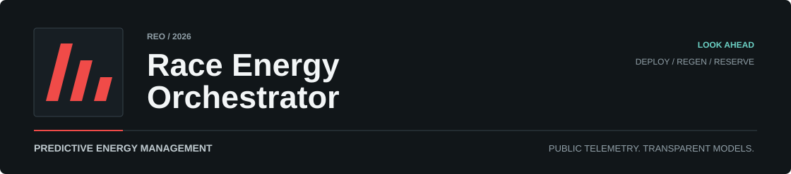
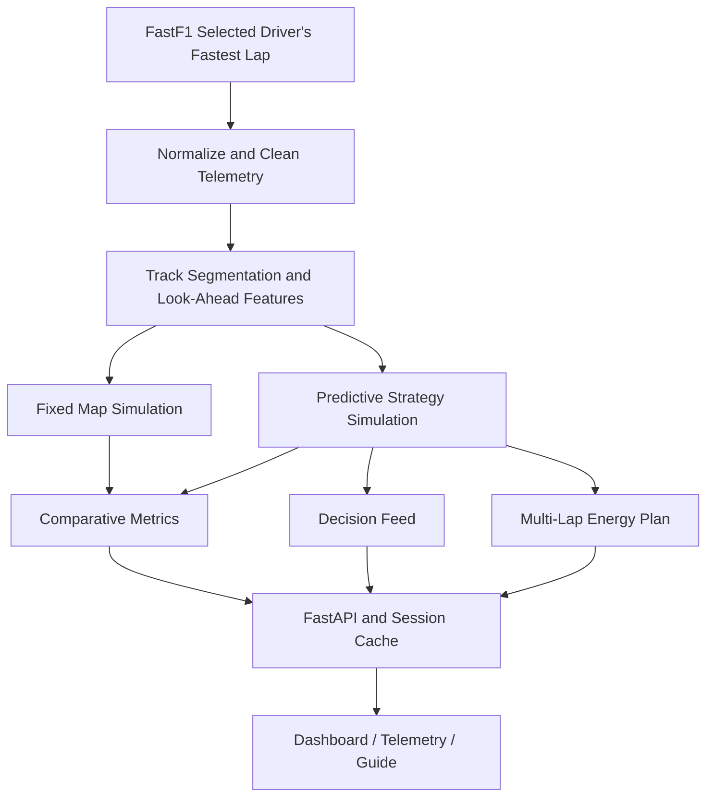

  

  <strong>Deploy with purpose. Recover with foresight. Protect the finish reserve.</strong> 
  Predictive hybrid energy management and clipping prevention built around 2026 race telemetry.

  <strong>Python</strong> · FastAPI · FastF1 · NumPy · pandas · Plotly 
  2026 session scope · TR / EN interface · Dark / light themes

  <a href="#the-problem">The Problem</a> ·
  <a href="#the-engineering-workspace">Workspace</a> ·
  <a href="#system-architecture">Architecture</a> ·
  <a href="#data-and-model-boundaries">Data Boundaries</a>

---

## The Problem

Electrical deployment is an energy-budget decision. Spending too much early in a lap can leave too little reserve for a later straight; protecting every joule can sacrifice useful acceleration. Regeneration, battery temperature, and the desired finish reserve complicate that trade-off.

**Race Energy Orchestrator (REO)** compares a fixed deployment map with a predictive strategy that considers the track ahead. It brings energy use, recovery, thermal protection, and clipping prevention into one engineering workspace, making both the decision and its modeled consequences inspectable.

In the simulation, **clipping** means requested electrical deployment cannot be delivered because energy is insufficient. Thermal power limiting is tracked separately. An elevated potential clipping risk describes future energy demand, rather than clipping that has already occurred.

## The Engineering Workspace

| Surface | Engineering Question | What It Shows |
| --- | --- | --- |
| **Dashboard** | What changed between the two strategies? | Modeled lap-time difference, clipping reduction, final SoC, and control score. |
| **Decision Console** | What action does the controller recommend here? | Command, bilingual rationale, severity, battery state, potential risk, and time to the next straight. |
| **Track Energy Plan** | Where is energy spent, recovered, or held? | Command segments linked to the decision console and chart cursor. |
| **Strategy Telemetry** | How did each strategy behave across the lap? | Deployment comparison, regeneration, SoC, potential clipping risk, and battery temperature. |
| **Stint Planner** | How should the energy budget evolve over several laps? | A five-lap default plan with build, normal, attack, recovery, and cooling modes. |
| **Telemetry Explorer** | Which samples explain the result? | Filterable strategy records, command selection, risk thresholds, charts, and pagination. |
| **Engineering Guide** | What do these signals mean? | Input contracts, decision logic, workflow, and model boundaries. |

The web workspace keeps session selection, language, and theme consistent across its pages. Session changes fetch API data without a page reload. Selecting a chart point, track segment, or timeline event pauses the replay and focuses the corresponding decision.

## System Architecture

The Python backend owns telemetry loading, track features, strategy requests, battery simulation, metrics, and planning. The separate HTML/CSS/JavaScript client presents those results through Plotly charts and synchronized decision views.

| Layer | Responsibility | Implementation |
| --- | --- | --- |
| Telemetry | Load the selected driver's fastest lap; normalize units and clean samples. | [`data.py`](src/race_energy_orchestrator/data.py) |
| Track Features | Classify segments, infer aero modes, and identify upcoming straight demand. | [`segmentation.py`](src/race_energy_orchestrator/segmentation.py) |
| Strategy | Generate fixed and predictive deploy/regen requests. | [`strategy.py`](src/race_energy_orchestrator/strategy.py) |
| Simulation | Apply energy limits, efficiencies, temperature dynamics, and power constraints. | [`model.py`](src/race_energy_orchestrator/model.py) |
| Analysis | Calculate comparative metrics and emit operator decisions. | [`metrics.py`](src/race_energy_orchestrator/metrics.py), [`live.py`](src/race_energy_orchestrator/live.py) |
| Planning | Project a bounded multi-lap energy budget from a representative lap. | [`stint.py`](src/race_energy_orchestrator/stint.py) |
| Delivery | Validate API contracts and share session loads across requests. | [`api.py`](src/race_energy_orchestrator/api.py), [`session_cache.py`](src/race_energy_orchestrator/session_cache.py) |
| Presentation | Session selection, localization, replay, filtering, and visual analysis. | [`web/`](web/) |

## Predictive Energy Control

The fixed map requests power according to the current segment, throttle, braking, and inferred aero state. The predictive strategy also examines upcoming long straights and reserves energy for future demand and the lap finish. On long straights, it spreads available energy over the remaining straight duration instead of requesting maximum power throughout.

The controller currently uses **rule-based look-ahead budgeting**. Its internal identifier is `predictive_mpc`; it does not solve a numerical model predictive control optimization problem.

The battery model limits actual deployment and regeneration according to available energy, capacity, efficiency, and temperature. The decision feed converts the resulting trace into four operator commands:

| Command | Meaning |
| --- | --- |
| `DEPLOY NOW` | Deployment meets the configured operator threshold, without a higher-priority hold or protection condition. |
| `REGEN PRIORITY` | Regeneration meets the recovery threshold. |
| `ENERGY HOLD` | Preserve the energy budget or respond to potential/realized clipping. |
| `THERMAL PROTECT` | Prioritize thermal headroom as battery temperature constrains deployment. |

The stint planner extends this analysis across **3–10 projected laps**, with five as the default. It schedules `BUILD`, `NORMAL`, `ATTACK`, `RECOVER`, or `COOL` modes while maintaining capacity and minimum-reserve bounds. These projections reuse a representative lap; they are not measured future race laps.

## Configurable Model Profile

The defaults below describe the project's **2026-style simulation profile**, rather than a measured car specification or a claim of regulatory compliance. All values live in [`EnergyConfig`](src/race_energy_orchestrator/config.py).

| Parameter | Default | Role |
| --- | --- | --- |
| MGU-K deploy / regen cap | 350 / 350 kW | Maximum requested electrical power. |
| Energy Store capacity | 4.00 MJ | Upper bound on modeled battery energy. |
| Initial / minimum energy | 3.15 / 0.18 MJ | Starting state and protected lower bound. |
| Target finish reserve | 0.45 MJ | Predictive deployment reserve target. |
| Deploy / regen efficiency | 0.96 / 0.72 | Conversion factors in the energy balance. |
| Initial battery / ambient temperature | 43 / 28 °C | Thermal simulation initial conditions. |
| Soft / hard thermal limit | 58 / 68 °C | Temperature thresholds for power limiting. |
| Look-ahead horizon | 30 s | Upcoming straight demand considered by the controller. |
| Operator deploy threshold | 200 kW | Threshold for the deployment command. |

## Data and Model Boundaries

The live API is scoped to **2026**, with 24 configured venues and `Q`, `R`, `FP1`, `FP2`, and `FP3` session choices. It requests real FastF1 lap telemetry and does not silently substitute synthetic laps. A configured future event returns `409`; unavailable FastF1 telemetry returns `503`. Passing the event-date check does not guarantee FastF1 has published the requested session.

| Signal | Basis | Interpretation |
| --- | --- | --- |
| Time, speed, throttle, brake, gear | FastF1 car telemetry | Public telemetry from the selected lap, normalized and cleaned. |
| Distance | FastF1 distance calculation | Derived lap distance, not a measured circuit map. |
| Segment and active aero state | Track-feature rules | Inferred categories, not actual aero actuator telemetry. |
| SoC, deploy, regen, battery temperature | Energy and thermal simulation | Configurable estimates, not measured ERS or battery channels. |
| Potential clipping risk | Uncovered upcoming energy demand | An energy shortfall indicator, not a calibrated failure probability. |
| Lap-time gain and loss | Configurable performance proxy | A comparison within the model, not a measured improvement on track. |
| Confidence and control score | Heuristic scoring | Decision-support indicators, not statistical guarantees. |

**Replay is not a live race feed.** The console steps through decisions calculated from a loaded lap. Energy recommendations, future-lap budgets, and performance deltas remain model outputs.

Explicit offline report generation can use deterministic synthetic laps for experiments and scenario comparisons. That capability is separate from the live API's real-telemetry requirement. Synthetic laps are simplified proxies, not faithful reproductions of each circuit's geometry.

## Backend Reliability

Session identity is keyed by **year, track, session, and driver**. Session and driver codes are normalized before lookup.

- **Shared loading:** simultaneous requests for the same selection share one load and simulation.
- **Independent access:** loading a new session does not block reads of already cached sessions.
- **Bounded retention:** up to 16 results per server process, with a 30-minute lifetime and least-recently-used eviction.
- **Failure cooldown:** unavailable FastF1 data is retained for 30 seconds; responses include `Retry-After: 30`.
- **Fresh retries:** future-event errors and unexpected model failures are not cached.

The cache is in memory and local to each server process. Restarting clears it; separate workers do not share it. Tests cover concurrent success and failure, independent sessions, expiration, eviction, recovery, and invalidation during loading.

## API Surface

| Endpoint | Contract |
| --- | --- |
| `/api/health` | Service liveness; does not verify telemetry availability. |
| `/api/options` | Configured year, venues, and session choices. |
| `/api/session` | Selection context, data provenance, and model parameters. |
| `/api/metrics` | Fixed-map and predictive strategy comparison. |
| `/api/trace` | Both strategies' lap traces for charts. |
| `/api/decision` | One indexed operator decision. |
| `/api/decisions` | Paginated decision records. |
| `/api/explorer` | Detailed records for both strategies. |
| `/api/scenarios` | Baseline, hot, low-SoC, and thermal-stress comparisons. |
| `/api/stint-plan` | Projected energy plan for a configurable lap horizon. |

---

**Race Energy Orchestrator is an independent engineering prototype.** It is team-neutral and intended for inspecting energy strategy trade-offs using public telemetry and transparent model assumptions.
